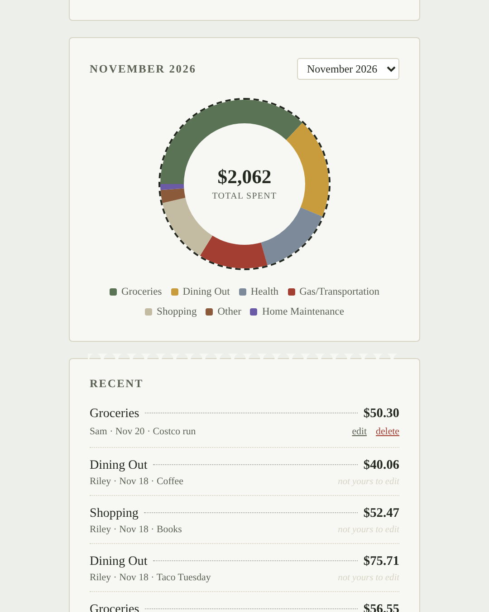
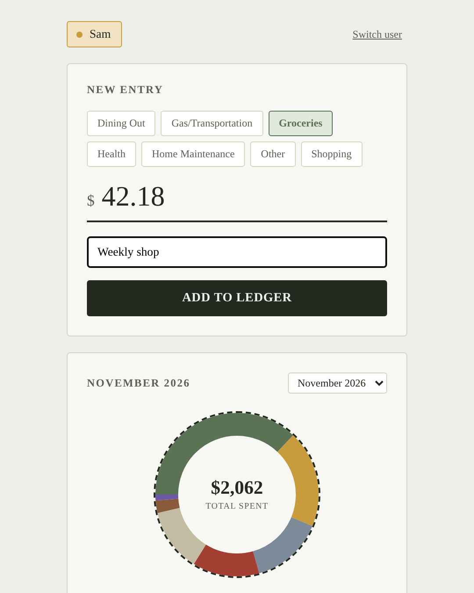
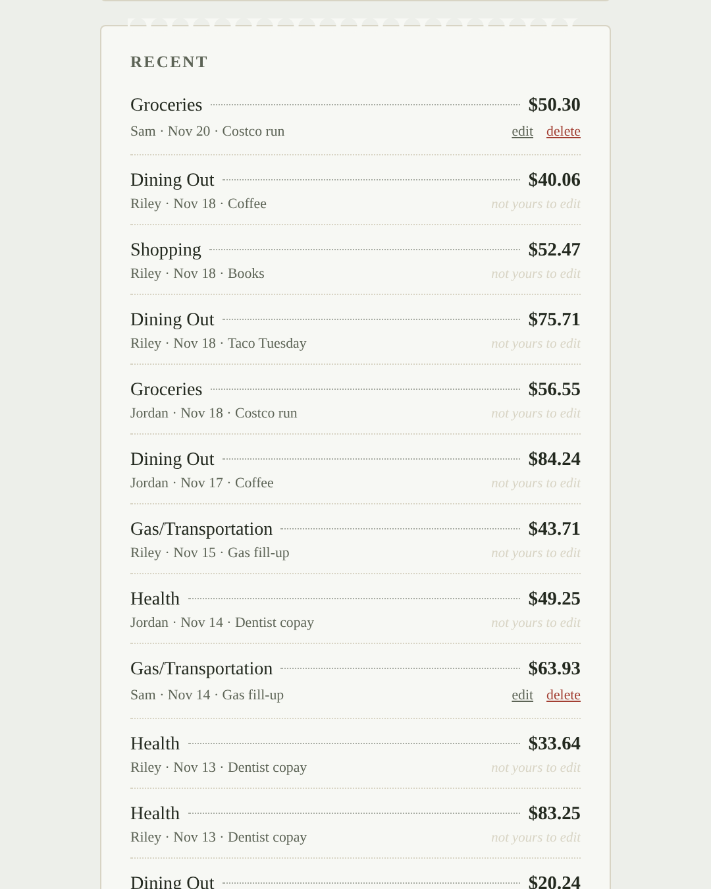

# Family Ledger

A household expense tracker: pick a category, log an amount, and see a
monthly donut chart broken down by category — click any slice to drill into
who spent what. No bank linking. Reachable from anywhere with just a normal
web link, no VPN or app installs for the family.

Built with Next.js (deploys to Vercel) and Postgres (hosted free on
Supabase).

## Screenshots

Mock data only (fake names and amounts).

| Summary | New entry | Recent |
| --- | --- | --- |
|  |  |  |

---

## 1. Set up the database (Supabase)

1. Go to [supabase.com](https://supabase.com) and open (or create) your
   project.
2. In the left sidebar: **SQL Editor** → **New query**.
3. Open `schema.sql` from this folder, paste its contents in, and click
   **Run**. This creates the `users`, `categories`, and `expenses` tables
   and seeds the starting category list (Groceries, Dining Out,
   Gas/Transportation, Shopping, Health, Home Maintenance, Other).
4. Get your connection string: **Project Settings** (gear icon) →
   **Database** → under **Connection string**, choose the **Transaction
   pooler** option (port `6543`) — this one is built for serverless
   platforms like Vercel. Copy it and swap in your actual database
   password.

## 2. Deploy to Vercel

**Easiest path — no local setup needed:**

1. Push this folder to a new GitHub repository (Vercel can also accept a
   direct upload, but GitHub makes future updates a one-click redeploy).
2. Go to [vercel.com](https://vercel.com) → **Add New** → **Project** →
   import that repository.
3. Before clicking Deploy, expand **Environment Variables** and add:
   - `DATABASE_URL` — the Supabase connection string from step 1.4 above
   - `SESSION_SECRET` — any long random string. You can generate one at
     [randomkeygen.com](https://randomkeygen.com) (use a "CodeIgniter
     Encryption Key"-style long string) or run `openssl rand -hex 32` if
     you have a terminal handy.
4. Click **Deploy**. After a minute or two you'll get a live URL like
   `family-ledger-yourname.vercel.app` — that's it, that's the link your
   whole family bookmarks.

## 3. Using the app

- **First screen:** type your name and a password. The first time any
  name is used, that becomes the account — no separate signup step.
- **Staying logged in:** the session lasts a year, so each family member
  logs in once per device and it just remembers them after that.
- **Add an expense:** pick a category, type the amount, optionally add a
  note, hit "Add to ledger." It's attributed to whoever's logged in
  automatically.
- **Donut chart:** shows the current month's spending by category, with a
  dropdown to look back at past months. Click any ring segment (or its
  label below) to drill into that category and see who spent what within
  it. Click "back to categories" to return.
- **Edit / delete:** only visible on your own entries — everyone else's
  just show "not yours to edit." This is enforced on the server, not just
  hidden in the interface, so it holds even if someone tried to bypass the
  app itself. Delete requires a confirm tap and automatically cancels
  after 4 seconds if you don't confirm, so a stray tap can't wipe an entry.
- **Manage categories:** a link at the bottom lets you add more categories
  beyond the starting seven.

## Updating the app later

Since it's connected to GitHub, any change you push to the repository
auto-deploys to Vercel within a minute or two. If you ever want me to help
add a feature (recurring subscriptions, for instance), I can hand you
updated files to commit.

## Local development (optional)

If you ever want to run this on your own computer to test changes before
deploying:

```bash
npm install
cp .env.example .env.local   # fill in DATABASE_URL and SESSION_SECRET
npm run dev
```

Then open `http://localhost:3000`.

## Security notes

- Passwords are hashed with bcrypt — never stored in plain text.
- Sessions are signed with `SESSION_SECRET` so they can't be forged.
- Edit/delete ownership checks happen in the API routes themselves
  (`app/api/expenses/[id]/route.js`), so they can't be bypassed by
  tampering with the browser.
- There's no email verification or password-reset flow — this is designed
  for a small trusted household, not a public product. If someone forgets
  their password, the simplest fix is deleting their row from the `users`
  table in Supabase's table editor and having them log in again to
  recreate the account (they'll lose the old password, but keep their past
  expense history, since expenses reference the user's ID, not their
  password).
